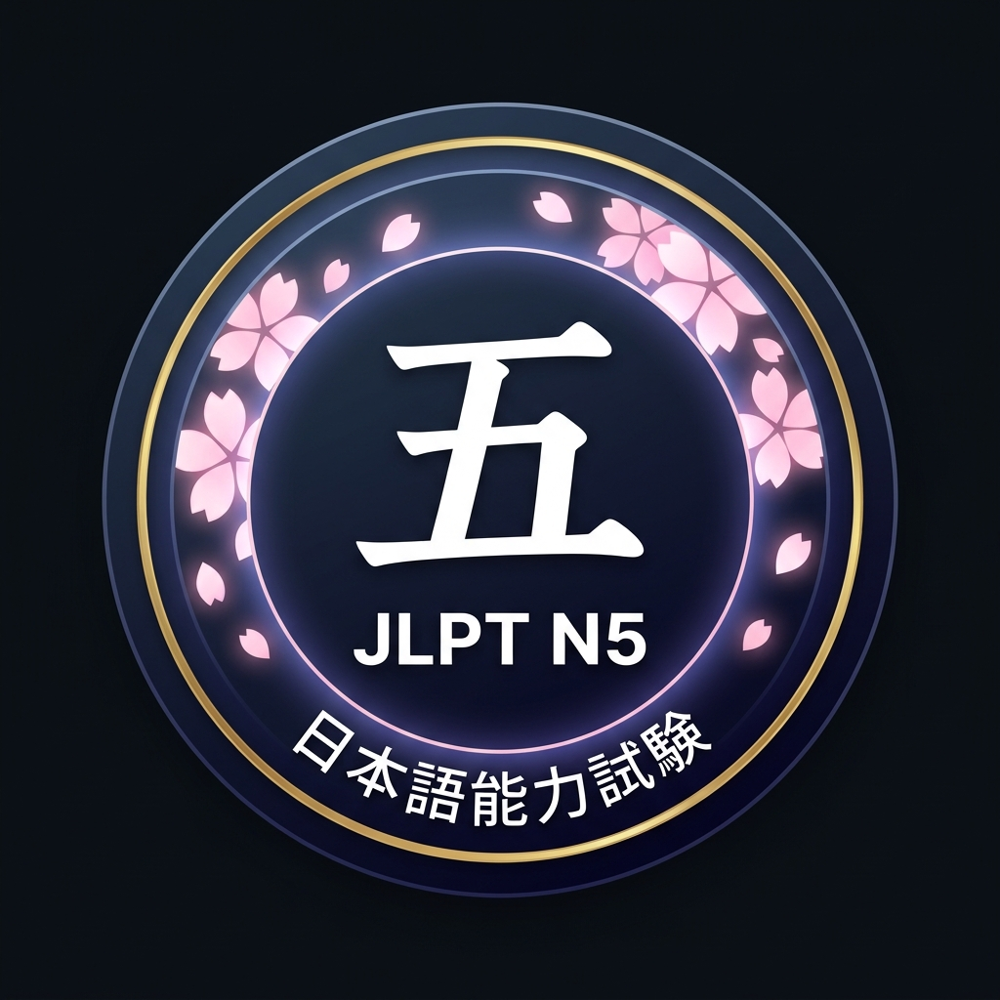
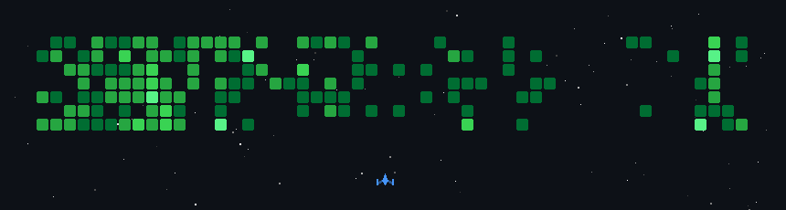

<!-- ═══════════════════════════════════════════════════════════════════════ -->
<!--                           HEADER SECTION                            -->
<!-- ═══════════════════════════════════════════════════════════════════════ -->

<div align="center">
  
</div>

<div align="center">
  
</div>

<!-- ═══════════════════════════════════════════════════════════════════════ -->
<!--                         SOCIAL BADGES                               -->
<!-- ═══════════════════════════════════════════════════════════════════════ -->

<div align="center">
  <a href="https://linkedin.com/in/prasannanadrajan" target="_blank">
    
  </a>
  <a href="mailto:prasannanadrajan.r@gmail.com">
    
  </a>
  <a href="https://prasazx.tech" target="_blank">
    
  </a>
  <a href="https://github.com/Prasanna-Nadrajan?tab=repositories" target="_blank">
    
  </a>
</div>

<div align="center">
  <br />
  
  
  
</div>

<br />

<!-- ═══════════════════════════════════════════════════════════════════════ -->
<!--                           ABOUT ME                                  -->
<!-- ═══════════════════════════════════════════════════════════════════════ -->

<h3 align="center">📊 Data Analyst @ Hyundai Motor India · AI/ML Engineer · Full-Stack Developer</h3>

<p align="center">
  Data Analyst at <b>Hyundai Motor India Limited</b>, building continuous control monitoring systems and automating audits at enterprise scale. <br />
  Specialized in <b>Machine Learning, Computer Vision, and Remote Sensing</b> with production-level experience in predictive analytics. <br />
  Passionate about transforming raw data into <b>actionable intelligence</b> and deploying <b>scalable, data-driven solutions</b>.
</p>

<details>
<summary align="center"><b>⚡ Quick Facts About Me</b></summary>
<br />

```yaml
name: Prasanna Nadrajan R
location: Chennai, India
current_role: Data Analyst @ Hyundai Motor India Limited
background: AI & Data Science (B.Tech, Rajalakshmi Engineering College)

specializations:
  - Predictive Analytics & Business Intelligence
  - Machine Learning & Deep Learning
  - Computer Vision & Image Processing
  - Remote Sensing & Geospatial Intelligence
  - Full-Stack Development
  - Continuous Control Monitoring & Audit Automation

currently_exploring:
  - MLOps & Production Model Deployment
  - Transformer Architectures
  - Advanced Satellite Image Processing
  - AWS Cloud Architecture

languages_spoken:
  - English  🇬🇧
  - Tamil    🇮🇳
  - Japanese 🇯🇵  (JLPT N5)   # 少しだけ日本語が話せます ✨

hobbies:
  - Competitive Programming
  - Open Source Contributing
  - Exploring New Tech
```

</details>

---

<!-- ═══════════════════════════════════════════════════════════════════════ -->
<!--                       CERTIFICATIONS & BADGES                       -->
<!-- ═══════════════════════════════════════════════════════════════════════ -->

## 🎖️ Certifications & Badges

<div align="center">

<table>
  <tr>
    <td align="center" valign="top" width="200">
      <a href="https://www.credly.com/badges/5499c14d-2b3c-4bf5-bfb4-047287c2c624" target="_blank">
        
      </a>
      <br />
      <b>AWS Certified AI Practitioner</b>
      <br />
      
    </td>
    <td width="40"></td>
    <td align="center" valign="top" width="200">
      
      <br />
      <b>JLPT N5 Certified</b>
      <br />
      
    </td>
  </tr>
</table>

</div>

---

<!-- ═══════════════════════════════════════════════════════════════════════ -->
<!--                    GITHUB STATS & METRICS                           -->
<!-- ═══════════════════════════════════════════════════════════════════════ -->

## 📊 GitHub Stats & Open Source Contributions

<div align="center">

  <!-- GitHub Stats Card -->
  
  
  <!-- Streak Stats (demolab) -->
  

</div>

<div align="center">

  <!-- Top Languages -->
  

</div>

<!-- Contribution Heatmap / Activity -->
<div align="center">
  
</div>

---

<!-- ═══════════════════════════════════════════════════════════════════════ -->
<!--                        OS CONTRIBUTION METRICS                      -->
<!-- ═══════════════════════════════════════════════════════════════════════ -->

## 🌍 Open Source Contribution Metrics

<div align="center">

  
  
  

</div>

<div align="center">
  
</div>

---

<!-- ═══════════════════════════════════════════════════════════════════════ -->
<!--                          GITHUB HIGHLIGHTS                          -->
<!-- ═══════════════════════════════════════════════════════════════════════ -->

## 🏆 GitHub Highlights

<div align="center">

  <!-- PRs merged, reviews & discussions — data unique to this section -->
  
  <!-- Compact language breakdown — different view from the donut above -->
  

</div>

---

<!-- ═══════════════════════════════════════════════════════════════════════ -->
<!--                        TECHNICAL TOOLKIT                            -->
<!-- ═══════════════════════════════════════════════════════════════════════ -->

## 🛠 Technical Toolkit

<div align="center">

### 🔤 Languages


### 🤖 Machine Learning & Data Science


### 🌐 Web & Frameworks


### 🗄️ Databases & Cloud


### 🔧 Tools & Platforms


</div>

---

<!-- ═══════════════════════════════════════════════════════════════════════ -->
<!--                         WORK EXPERIENCE                             -->
<!-- ═══════════════════════════════════════════════════════════════════════ -->

## 💼 Work Experience

<table align="center">
  <thead>
    <tr>
      <th>🏢 Role</th>
      <th>🏛️ Company</th>
      <th>📅 Duration</th>
      <th>📝 Description</th>
    </tr>
  </thead>
  <tbody>
    <tr>
      <td><b>Intern Trainee</b></td>
      <td><b>Indian Space Academy</b></td>
      <td>Dec 2025 - Feb 2026</td>
      <td>Analyzing satellite imagery and geospatial data using QGIS and ArcGIS for environmental studies.</td>
    </tr>
    <tr>
      <td><b>Data Analyst Associate</b></td>
      <td><b>Analyse Research Quant (ARQ)</b></td>
      <td>Sep 2025 - Aug 2026</td>
      <td>Leading Technical Events of the Dept of Artificial Intelligence and Data Science Club and building predictive models with 85%+ accuracy.</td>
    </tr>
    <tr>
      <td><b>Data Analyst Intern</b></td>
      <td><b>Hyundai Motor India Limited</b></td>
      <td>Aug 2026 - Present</td>
      <td>Building Continuous Control Monitoring Systems, Automating Audits, Building predictive analytics models and driving business insights through large-scale data analysis.</td>
    </tr>
  </tbody>
</table>

---

<!-- ═══════════════════════════════════════════════════════════════════════ -->
<!--                        FEATURED PROJECTS                            -->
<!-- ═══════════════════════════════════════════════════════════════════════ -->

## ✨ Featured Projects

<div align="center">

<table>
  <tr>
    <td width="50%" valign="top">
      <h3 align="center">🛰️ AI-Driven LULC Classification</h3>
      <p align="center">AI system using Random Forest & SVM on Sentinel-2 satellite imagery for accurate terrain mapping and land use classification.</p>
      <p align="center">
        
        
        
      </p>
    </td>
    <td width="50%" valign="top">
      <h3 align="center">🧬 eDNA-VAI-PIPELINE</h3>
      <p align="center">Deep Learning pipeline using Variational Autoencoders (VAE) to cluster and identify deep-sea biodiversity patterns.</p>
      <p align="center">
        
        
        
      </p>
    </td>
  </tr>
  <tr>
    <td width="50%" valign="top">
      <h3 align="center">🚑 Ambulance Detection System</h3>
      <p align="center">Real-time emergency vehicle detection using Computer Vision to automate traffic signal priority for faster response.</p>
      <p align="center">
        
        
        
      </p>
    </td>
    <td width="50%" valign="top">
      <h3 align="center">🏝️ Island Rescue Mission</h3>
      <p align="center">Crisis management dashboard using Power BI and Python ML to coordinate rescue operations and resource allocation.</p>
      <p align="center">
        
        
        
      </p>
    </td>
  </tr>
  <tr>
    <td width="50%" valign="top" colspan="2">
      <h3 align="center">🎬 StreamVerse OTT</h3>
      <p align="center">A modern streaming platform built with React, Vite, and TMDb API integration — featuring sleek UI and dynamic content.</p>
      <p align="center">
        
        
        
      </p>
    </td>
  </tr>
</table>

</div>

---

<!-- ═══════════════════════════════════════════════════════════════════════ -->
<!--                    ACHIEVEMENTS & CODING STATS                      -->
<!-- ═══════════════════════════════════════════════════════════════════════ -->

## 🏅 Achievements & Competitive Coding

<div align="center">

| 🏷️ Platform | 🎯 Achievement |
| :---: | :--- |
|  | ⭐ **5-Star Coder** — Python, C, Java, SQL, Problem Solving |
|  | 🧩 **200+ Problems Solved** — Data Structures & Algorithms |
|  | 🥉 **3rd Place** — Git-in-Kadhai Hackathon |

</div>

---

<!-- ═══════════════════════════════════════════════════════════════════════ -->
<!--                     CONTRIBUTION SNAKE                              -->
<!-- ═══════════════════════════════════════════════════════════════════════ -->

## 🐍 Contribution Graph

<div align="center">
  
</div>

<div align="center">
  <picture>
    <source media="(prefers-color-scheme: dark)" srcset="https://raw.githubusercontent.com/Prasanna-Nadrajan/Prasanna-Nadrajan/output/github-snake-dark.svg" />
    <source media="(prefers-color-scheme: light)" srcset="https://raw.githubusercontent.com/Prasanna-Nadrajan/Prasanna-Nadrajan/output/github-snake.svg" />
    
  </picture>
</div>

---

<!-- ═══════════════════════════════════════════════════════════════════════ -->
<!--                       RANDOM DEV QUOTE                              -->
<!-- ═══════════════════════════════════════════════════════════════════════ -->

<div align="center">
  
</div>

---

<!-- Japanese animation strip — subtle nod to N5, not the headline act 🌸 -->
<div align="center">
  
</div>

<!-- ═══════════════════════════════════════════════════════════════════════ -->
<!--                           FOOTER                                    -->
<!-- ═══════════════════════════════════════════════════════════════════════ -->
<p align="center">
  <b><i>"Turning data into insights and code into solutions."</i></b>
</p>

<p align="center">
  
</p>

<div align="center">
  
</div>
